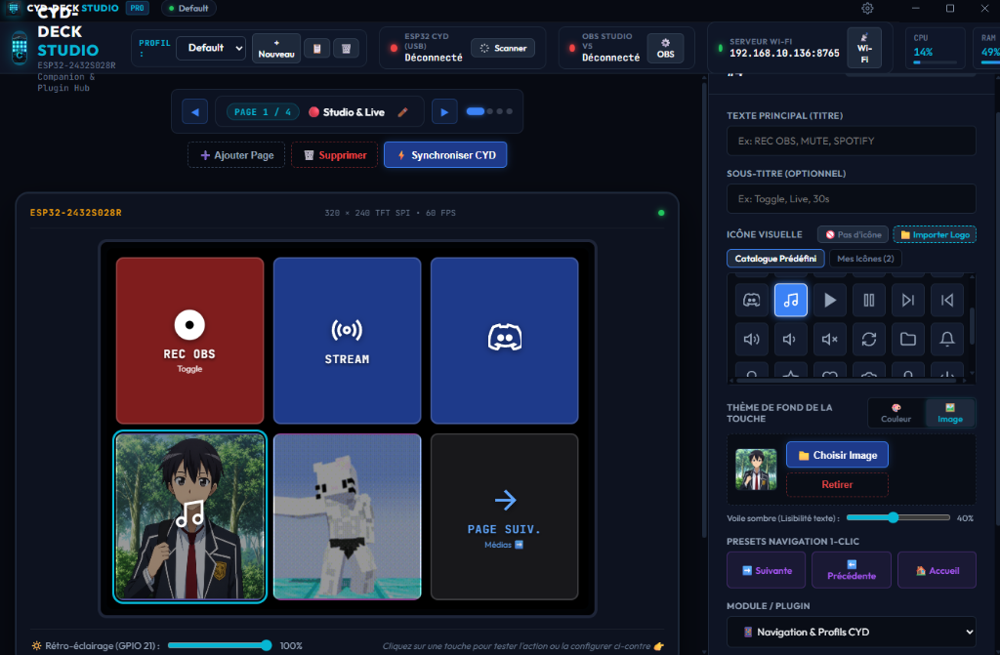

<!-- ══════════════════════════════════════════════════════════ -->
<!--  HEADER — Capsule Render waving                           -->
<!-- ══════════════════════════════════════════════════════════ -->

<!-- TYPING SVG -->

 

<!-- PROFILE COUNTERS -->

&nbsp;

  

<!-- LINKS -->

&nbsp;

&nbsp;

 

<!-- ══════════════════════════════════════════════════════════ -->
<!--  01 — ABOUT ME                                            -->
<!-- ══════════════════════════════════════════════════════════ -->

<table>
<tr>
<td width="60%" valign="top">

Hey, I'm **RIZYOX** — 18-year-old French IT student and self-taught developer focused on **cloud infrastructure, homelab virtualization, and full-stack engineering**.

- **Profile** — 18 y/o French IT Student & Autodidact Developer
- **Core Focus** — Cloud Infrastructure, Virtualization (Proxmox VE) & Systems Architecture
- **Homelab & SysAdmin** — Linux (Debian, Parrot OS), Docker, cloud-init automations
- **Dev** — Vanilla PHP, Node.js, TypeScript, Python, Discord bots
- **Anime Realm** — SAO · Mushoku Tensei · Tensura · Witch Hat Atelier
- **Portfolio** — [rizyox.fr](https://rizyox.fr)

> *"Stay curious, automate the repetitive, build reliable systems."*

</td>
<td width="40%" align="center" valign="middle">
  
   
  <b>Rimuru Tempest</b> // That Time I Got Reincarnated as a Slime
</td>
</tr>
</table>

 

<!-- ══════════════════════════════════════════════════════════ -->
<!--  02 — TECH STACK                                          -->
<!-- ══════════════════════════════════════════════════════════ -->

<table>
<tr>
<td width="38%" align="center" valign="middle">
  
   
  <b>Roxy Migurdia</b> // Mushoku Tensei
</td>
<td width="62%" valign="top">

 

<b>Categorized Overview</b>

 

| Domain | Technologies |
| :--- | :--- |
| **Backend & Core** | `Node.js` `Vanilla PHP` `Python` `TypeScript` |
| **Frontend & UI** | `HTML5` `CSS3` `JavaScript (ES6+)` `React / TSX` |
| **DevOps & Cloud** | `Docker` `Docker Compose` `Proxmox VE` `cloud-init` |
| **OS & SysAdmin** | `Debian` `Parrot OS` `Bash` `SSH` `Reverse Proxy` |
| **Tools & APIs** | `Git` `GitHub` `Discord.js API` `Proxmox API` `VS Code` |

</td>
</tr>
</table>

 

<!-- ══════════════════════════════════════════════════════════ -->
<!--  03 — FEATURED PROJECTS                                   -->
<!-- ══════════════════════════════════════════════════════════ -->

  

<table>
<td width="36%" align="center" valign="middle">
  
</td>
<td width="64%" valign="top">

**[CYD-Deck Studio](https://github.com/RIZYOX/CYD-ESP32-STREAM-DECK)** &nbsp;  &nbsp;  &nbsp; 

Next-gen ESP32 CYD touchscreen stream deck companion. Electron app with OBS WebSocket v5, Discord global hotkeys, Voicemod & Streamlabs integration, Wi-Fi WebSocket and USB serial.

`Electron` `Node.js` `C++ ESP32` `OBS` `Discord` `Voicemod`

</td>
</tr>
</tr>

<tr>
<td width="36%" align="center" valign="middle">
  
</td>
<td width="64%" valign="top">

**[Proxmox VPS Bot](https://github.com/RIZYOX)** &nbsp; 

Discord bot that creates and orchestrates Virtual Machines via the **Proxmox API**. Deploys fresh VMs with **cloud-init** OS and network setup using slash commands.

`Node.js` `Discord.js` `Proxmox API` `cloud-init`

</td>
</tr>

<tr>
<td width="36%" align="center" valign="middle">
  
</td>
<td width="64%" valign="top">

**[Tec Motoculture](https://tec-motoculture.fr)** &nbsp; 

Commercial showcase web app for an equipment retail company — responsive, fast, pure vanilla PHP with high SEO score.

`Vanilla PHP` `HTML5` `CSS3` `JavaScript`

</td>
</tr>

<tr>
<td width="36%" align="center" valign="middle">
  
</td>
<td width="64%" valign="top">

**Panel Gestion Location** &nbsp; 

Dashboard managing equipment rentals: reservation schedule, return tracking, deposit workflows, and customer data export.

`Vanilla PHP` `JavaScript` `Dashboard UI` `CSS3`

</td>
</tr>

<tr>
<td width="36%" align="center" valign="middle">
  
</td>
<td width="64%" valign="top">

**Panel Gestion RDV** &nbsp; 

Workshop appointment and repair tracking software — slot reservation, customer logs, diagnostics, and intervention history.

`Vanilla PHP` `JavaScript` `Calendar UI` `CSS3`

</td>
</tr>
</table>

  <a href="https://rizyox.fr/#projects" target="_blank"><i>View full live portfolio on rizyox.fr ➔</i></a>

 

<!-- ══════════════════════════════════════════════════════════ -->
<!--  04 — GITHUB ANALYTICS                                    -->
<!-- ══════════════════════════════════════════════════════════ -->

 

 

 

<!-- ACTIVITY GRAPH -->

  

<!-- CONTRIBUTION SNAKE -->
<picture>
  <source media="(prefers-color-scheme: dark)" srcset="https://raw.githubusercontent.com/RIZYOX/RIZYOX/output/github-snake-dark.svg"/>
  <source media="(prefers-color-scheme: light)" srcset="https://raw.githubusercontent.com/RIZYOX/RIZYOX/output/github-snake.svg"/>
  
</picture>

  

 
<b>Kirito</b> // Sword Art Online

 

<!-- ══════════════════════════════════════════════════════════ -->
<!--  05 — FAVORITE ANIME                                      -->
<!-- ══════════════════════════════════════════════════════════ -->

  

<table>
<tr>
<td align="center" width="25%" valign="top">
  
   
  <b>Sword Art Online</b> 
  Virtual Reality & Code
</td>
<td align="center" width="25%" valign="top">
  
   
  <b>Mushoku Tensei</b> 
  Magic Mastery & Growth
</td>
<td align="center" width="25%" valign="top">
  
   
  <b>Slime (Tensura)</b> 
  Architecture & Leadership
</td>
<td align="center" width="25%" valign="top">
  
   
  <b>Witch Hat Atelier</b> 
  Runic Glyphs & Curiosity
</td>
</tr>
</table>

 

<!-- ══════════════════════════════════════════════════════════ -->
<!--  06 — CONNECT                                             -->
<!-- ══════════════════════════════════════════════════════════ -->

 

&nbsp;

&nbsp;

  

<!-- ══════════════════════════════════════════════════════════ -->
<!--  FOOTER — Capsule Render wave                             -->
<!-- ══════════════════════════════════════════════════════════ -->

