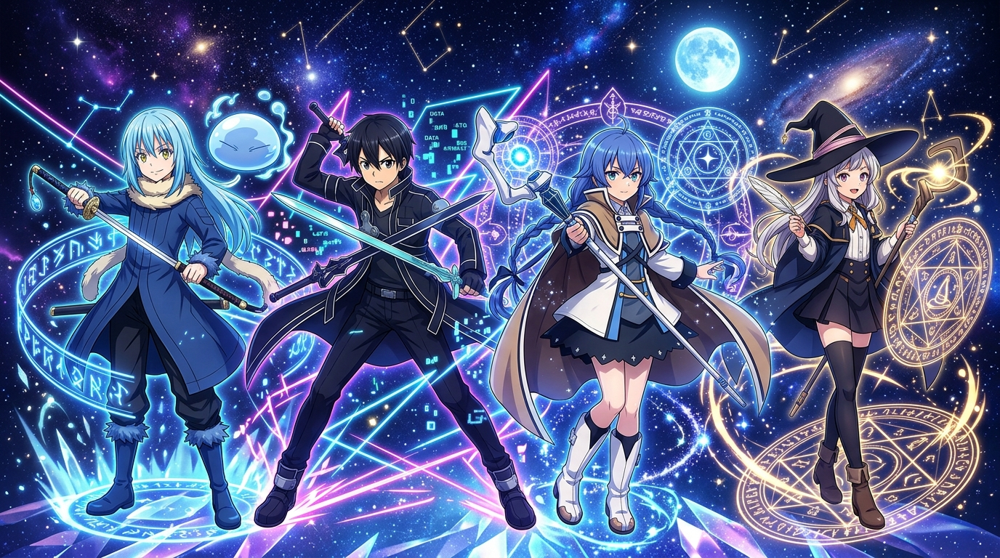
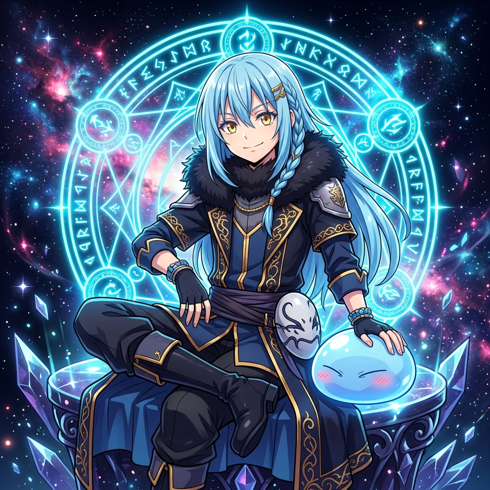
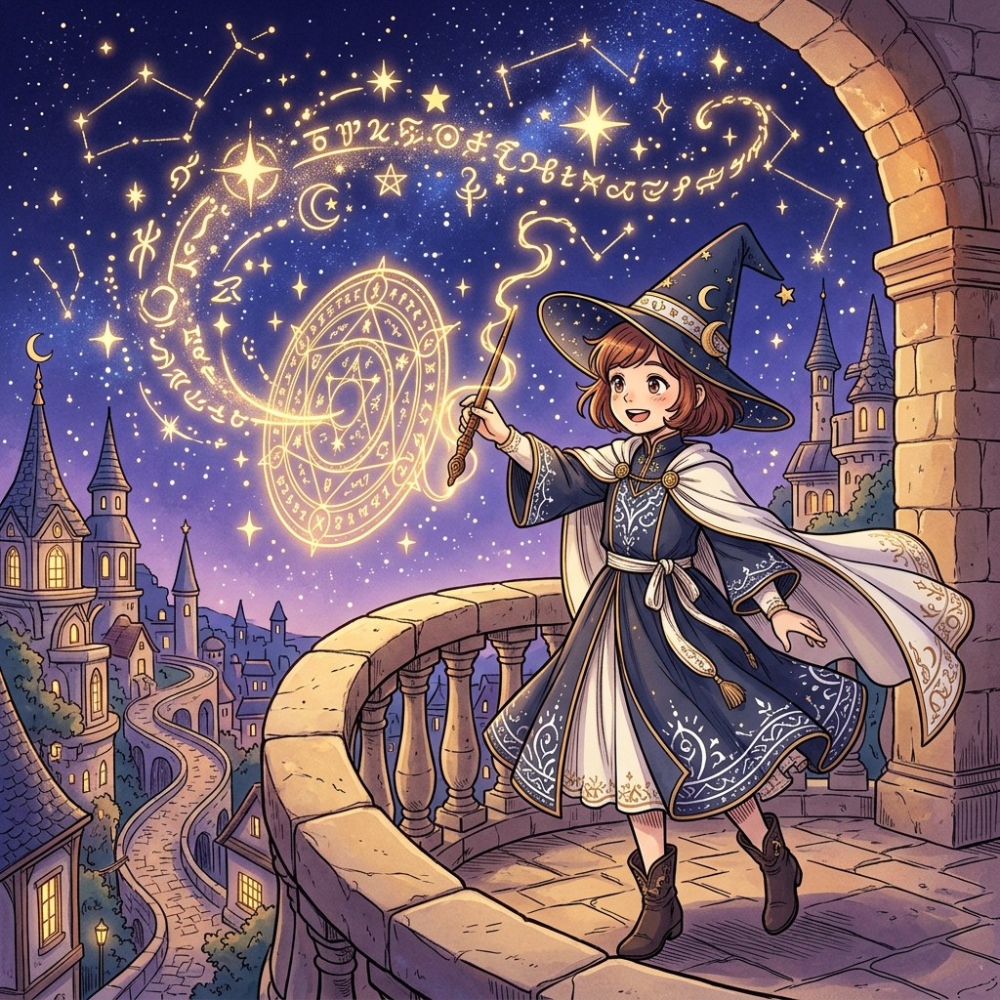
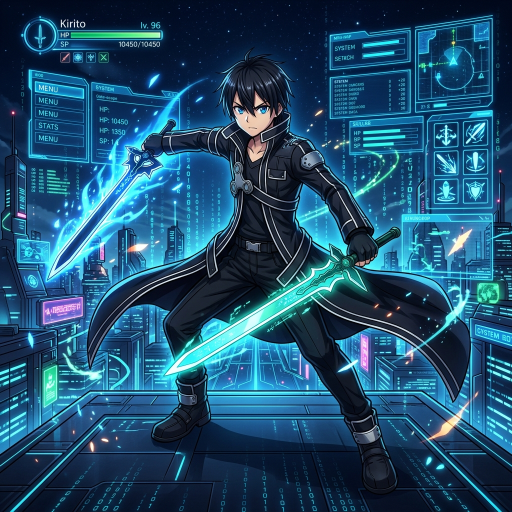
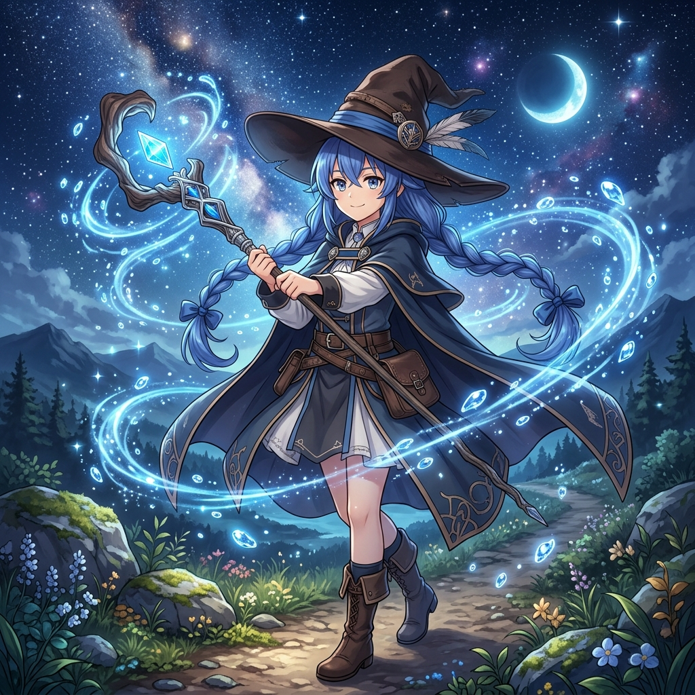

  <!-- ═══════════════════════════════════════════════════ -->
  <!-- TOP WAVING CAPSULE RENDER                           -->
  <!-- ═══════════════════════════════════════════════════ -->
  

   

  <!-- ═══════════════════════════════════════════════════ -->
  <!-- MAIN ANIME HERO BANNER                              -->
  <!-- ═══════════════════════════════════════════════════ -->
  

    
  

  <!-- TYPING SVG BADGE -->
  

    

  <!-- SOCIAL / CONTACT PILLS -->
  
  &nbsp;
  
  &nbsp;
  

 

<!-- ═══════════════════════════════════════════════════ -->
<!-- ABOUT ME SECTION (SPLIT WITH CHARACTER ART)         -->
<!-- ═══════════════════════════════════════════════════ -->
<table>
  <tr>
    <td width="60%" valign="top">
      <h2>👤 <code>about_me.sys</code></h2>
      

        Hey there! 👋 I'm <b>RIZYOX</b>, an 18-year-old <b>French IT student</b> and passionate builder exploring the frontiers of <b>cloud virtualization, homelab orchestration, and full-stack development</b>.
      

      <ul>
        <li>🎓 <b>Identity:</b> 18 y/o French IT Student & Self-taught Developer</li>
        <li>🔭 <b>Specialties:</b> Cloud Virtualization (Proxmox VE), Containerization & Microservices</li>
        <li>⚡ <b>Homelab & Sysadmin:</b> Linux (Debian, Parrot OS), Docker & Compose, cloud-init automations</li>
        <li>💻 <b>Software Dev:</b> Vanilla PHP (no frameworks), modern JavaScript/TypeScript, Python & Discord bots</li>
        <li>⚔️ <b>Anime Obsessions:</b> <i>Sword Art Online</i>, <i>Mushoku Tensei</i>, <i>That Time I Got Reincarnated as a Slime</i>, <i>Witch Hat Atelier</i></li>
        <li>🚀 <b>Portfolio:</b> <a href="https://rizyox.fr" target="_blank"><b>rizyox.fr</b></a></li>
      </ul>
      

        <i>"In code as in magic, every line written with precision and curiosity shapes a new reality."</i>
      

    </td>
    <td width="40%" align="center" valign="middle">
      
       
      <b>Rimuru Tempest</b> • <i>"Building a realm where everyone thrives."</i>
    </td>
  </tr>
</table>

 

<!-- ═══════════════════════════════════════════════════ -->
<!-- TECH ARSENAL & SKILLS                               -->
<!-- ═══════════════════════════════════════════════════ -->
<table>
  <tr>
    <td width="38%" align="center" valign="middle">
      
       
      <b>Coco</b> • <i>"Inscribing magic into every system."</i>
    </td>
    <td width="62%" valign="top">
      <h2>🪄 <code>skills_and_stack.json</code></h2>
      
Tools, languages and technologies I use to build production platforms and manage infrastructure.

      

        <!-- SkillIcons modern dark icons -->
        
      

       

      

        
<b>📂 Categorized Overview</b>

         

| Category | Stack |
| :--- | :--- |
| **Backend & Core** | `Node.js`, `Vanilla PHP` (Pure & Framework-free), `Python`, `Rust`, `TypeScript` |
| **Frontend & UI** | `HTML5`, `CSS3` (Pure Vanilla Styling & Keyframes), `JavaScript (ES6+)`, `React`, `TSX` |
| **DevOps & Cloud** | `Docker`, `Docker Compose`, `Proxmox VE (VMs & LXC)`, `cloud-init`, `VPS Automation` |
| **OS & SysAdmin** | `Linux (Debian / Ubuntu / Parrot OS)`, `Bash scripting`, `SSH`, `Reverse Proxy` |
| **Tools & APIs** | `Git`, `GitHub`, `Discord.js API`, `Proxmox API`, `VS Code` |

      

    </td>
  </tr>
</table>

 

<!-- ═══════════════════════════════════════════════════ -->
<!-- FEATURED & DEPLOYED PROJECTS (WITH SCREENSHOTS)     -->
<!-- ═══════════════════════════════════════════════════ -->

  <h2>🚀 Featured & Deployed Projects</h2>
  
Real-world applications, internal tools, and automation systems deployed in production.

 

<table>
  <!-- ROW 1 -->
  <tr>
    <!-- PROJECT 1: PROXMOX VPS BOT -->
    <td width="50%" valign="top">
      
        
      

        <b>🤖 <a href="https://github.com/RIZYOX">Proxmox VPS Bot</a></b>
        
      

      

        Discord bot that automates Virtual Machine creation and management via the <b>Proxmox API</b>. Deploys fresh VMs on demand with <b>cloud-init</b> network and OS provisioning through slash commands.
      

      <code>Node.js</code> <code>Discord.js</code> <code>Proxmox API</code> <code>cloud-init</code>
    </td>

    <!-- PROJECT 2: TEC MOTOCULTURE -->
    <td width="50%" valign="top">
      
        
      

        <b>🌾 <a href="https://tec-motoculture.fr" target="_blank">Tec Motoculture</a></b>
        
      

      

        Production showcase website for a commercial equipment and garden machinery business. Ultra-fast, responsive, zero-framework vanilla PHP implementation with clean SEO score.
      

      <code>Vanilla PHP</code> <code>HTML5</code> <code>CSS3</code> <code>JavaScript</code>
    </td>
  </tr>

  <!-- ROW 2 -->
  <tr>
    <!-- PROJECT 3: PANEL GESTION LOCATION -->
    <td width="50%" valign="top">
      
        
      

        <b>📦 Panel Gestion Location</b>
        
      

      

        Tailored internal business dashboard to streamline equipment rentals: interactive schedule calendar, return tracking, deposit workflows, and comprehensive data export.
      

      <code>Vanilla PHP</code> <code>JavaScript</code> <code>Dashboard UI</code> <code>CSS3</code>
    </td>

    <!-- PROJECT 4: PANEL GESTION RDV -->
    <td width="50%" valign="top">
      
        
      

        <b>📅 Panel Gestion RDV</b>
        
      

      

        Workshop appointment booking and repair tracking software: calendar slot allocation, customer logs, repair diagnostics, and intervention history filter.
      

      <code>Vanilla PHP</code> <code>JavaScript</code> <code>Calendar UI</code> <code>CSS3</code>
    </td>
  </tr>
</table>

  <a href="https://rizyox.fr/#projects" target="_blank"><i>🔗 View full live portfolio on rizyox.fr ➔</i></a>

 

<!-- ═══════════════════════════════════════════════════ -->
<!-- GITHUB STATS & SAO CYBER HUD                        -->
<!-- ═══════════════════════════════════════════════════ -->
<table>
  <tr>
    <td width="65%" valign="middle">
      

        <h2>📊 GitHub Analytics & Matrix</h2>
        
Live commit metrics, streaks and language composition.

        <!-- STATS CARD -->
        
          

        <!-- TOP LANGS CARD -->
        
          

        <!-- STREAK STATS -->
        
      

    </td>
    <td width="35%" align="center" valign="middle">
      
       
      <b>Kirito</b> • <i>"Link Start: Level 96 Dual Wielder."</i>
    </td>
  </tr>
</table>

 

<!-- ═══════════════════════════════════════════════════ -->
<!-- ANIME HALL OF FAME                                  -->
<!-- ═══════════════════════════════════════════════════ -->

  <h2>✨ Favorite Anime Universes</h2>
  
The masterpieces that drive my creativity and imagination.

 

<table>
  <tr>
    <td align="center" width="25%" valign="top">
      
       
      <b>⚔️ Sword Art Online</b> 
      Virtual Realities, NerveGear & Cyber Systems
    </td>
    <td align="center" width="25%" valign="top">
      
       
      <b>🪄 Mushoku Tensei</b> 
      Magic Mastery, World Growth & Adventure
    </td>
    <td align="center" width="25%" valign="top">
      
       
      <b>👑 Slime (Tensura)</b> 
      Kingdom Architecture & Great Sage Logic
    </td>
    <td align="center" width="25%" valign="top">
      
       
      <b>✨ Witch Hat Atelier</b> 
      Runic Spell Inscription & Boundless Curiosity
    </td>
  </tr>
</table>

 

<!-- ═══════════════════════════════════════════════════ -->
<!-- GET IN TOUCH                                        -->
<!-- ═══════════════════════════════════════════════════ -->

  <h2>📫 Connect With Me</h2>
  
Whether you want to discuss infrastructure, homelabs, development, or anime — my DMs are always open!

  

    
    &nbsp;
    
    &nbsp;
    
  

   

  <!-- ═══════════════════════════════════════════════════ -->
  <!-- WAVING FOOTER CAPSULE RENDER                        -->
  <!-- ═══════════════════════════════════════════════════ -->
  

