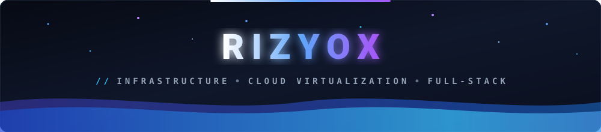
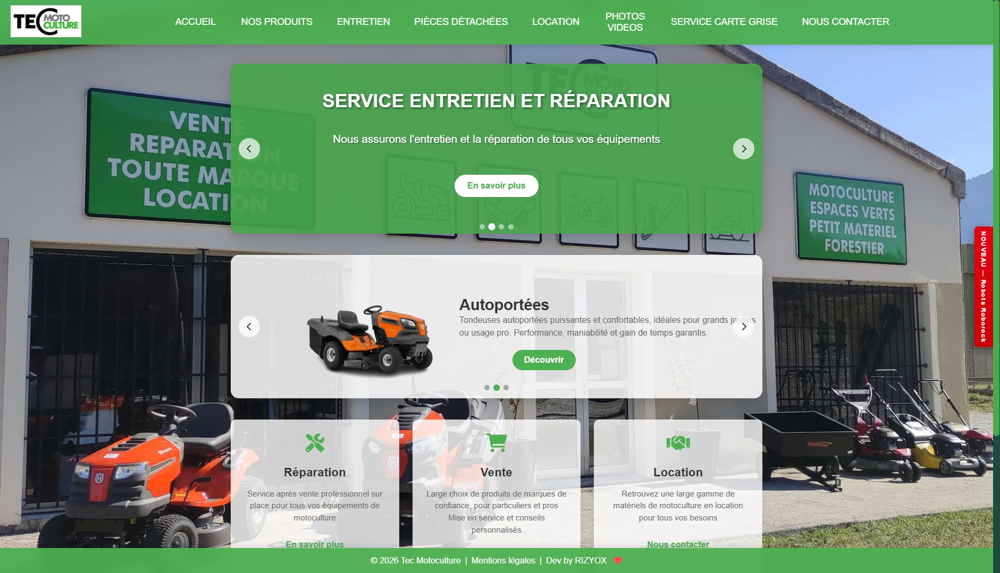
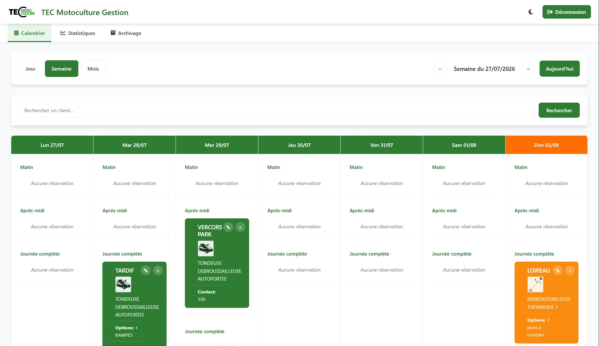
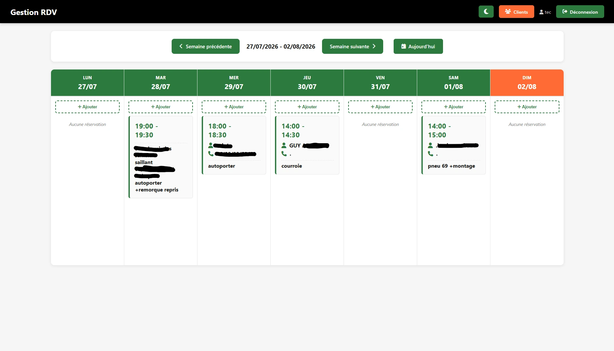

<!-- ═══════════════════════════════════════════════════ -->
<!-- ANIMATED HEADER SVG (LOCALLY HOSTED, 100% RELIABLE) -->
<!-- ═══════════════════════════════════════════════════ -->

  

<!-- ═══════════════════════════════════════════════════ -->
<!-- HERO BANNER (SWORD ART ONLINE — AINCRAD)            -->
<!-- ═══════════════════════════════════════════════════ -->

  

<!-- TYPING SVG BADGE -->

  

<!-- QUICK BADGES -->

&nbsp;

&nbsp;

 

<!-- ═══════════════════════════════════════════════════ -->
<!-- 01 — ABOUT ME                                       -->
<!-- ═══════════════════════════════════════════════════ -->
<table>
<tr>
<td width="62%" valign="top">

Hey there, I'm <b>RIZYOX</b>. 18-year-old French IT student and self-taught enthusiast focused on <b>cloud infrastructure, homelab virtualization, and full-stack software development</b>.

<ul>
<li><b>Profile:</b> 18 y/o French IT Student & Autodidact Developer</li>
<li><b>Core Focus:</b> Cloud Infrastructure, Virtualization (Proxmox VE) & Systems Architecture</li>
<li><b>Homelab & SysAdmin:</b> Linux (Debian, Parrot OS), Docker containerization, cloud-init automations</li>
<li><b>Development:</b> Vanilla PHP (zero-framework), Node.js, TypeScript, Python & Discord bots</li>
<li><b>Anime Realm:</b> Sword Art Online, Mushoku Tensei, That Time I Got Reincarnated as a Slime, Witch Hat Atelier</li>
<li><b>Current Goals:</b> High-availability clusters, automation workflows & production-grade engineering</li>
<li><b>Portfolio:</b> <a href="https://rizyox.fr" target="_blank"><b>rizyox.fr</b></a></li>
</ul>

<i>"Stay curious, automate repetitive tasks, and build reliable systems from the ground up."</i>

</td>
<td width="38%" align="center" valign="middle">

 
<b>Rimuru Tempest</b> // That Time I Got Reincarnated as a Slime
</td>
</tr>
</table>

 

<!-- ═══════════════════════════════════════════════════ -->
<!-- 02 — TECH STACK & ARSENAL                           -->
<!-- ═══════════════════════════════════════════════════ -->
<table>
<tr>
<td width="38%" align="center" valign="middle">

 
<b>Roxy Migurdia</b> // Mushoku Tensei
</td>
<td width="62%" valign="top">

Languages, runtimes, and infrastructure technologies utilized across my projects:

 

<b>Categorized Overview</b>

 

| Domain | Technologies |
| :--- | :--- |
| **Backend & Core** | `Node.js`, `Vanilla PHP` (Pure & Framework-free), `Python`, `Rust`, `TypeScript` |
| **Frontend & UI** | `HTML5`, `CSS3` (Pure Vanilla Styling & Keyframes), `JavaScript (ES6+)`, `React`, `TSX` |
| **DevOps & Cloud** | `Docker`, `Docker Compose`, `Proxmox VE (VMs & LXC)`, `cloud-init`, `VPS Automation` |
| **OS & SysAdmin** | `Linux (Debian / Ubuntu / Parrot OS)`, `Bash scripting`, `SSH`, `Reverse Proxy` |
| **Tools & APIs** | `Git`, `GitHub`, `Discord.js API`, `Proxmox API`, `VS Code` |

</td>
</tr>
</table>

 

<!-- ═══════════════════════════════════════════════════ -->
<!-- 03 — FEATURED PROJECTS                              -->
<!-- ═══════════════════════════════════════════════════ -->

Production platforms, internal tools and automation systems deployed in real-world environments.

 

<table>
<tr>
<td width="35%" align="center" valign="middle">

</td>
<td width="65%" valign="top">

<b><a href="https://github.com/RIZYOX">Proxmox VPS Bot</a></b> &nbsp; 

Automated Discord bot that creates and orchestrates Virtual Machines via the <b>Proxmox API</b>. Deploys fresh VMs with <b>cloud-init</b> OS and network setup using slash commands.

<code>Node.js</code> <code>Discord.js</code> <code>Proxmox API</code> <code>cloud-init</code>
</td>
</tr>
<tr>
<td width="35%" align="center" valign="middle">

</td>
<td width="65%" valign="top">

<b><a href="https://tec-motoculture.fr" target="_blank">Tec Motoculture</a></b> &nbsp; 

Commercial showcase web application built for an equipment retail company. Fast, responsive, pure vanilla PHP implementation with high SEO score.

<code>Vanilla PHP</code> <code>HTML5</code> <code>CSS3</code> <code>JavaScript</code>
</td>
</tr>
<tr>
<td width="35%" align="center" valign="middle">

</td>
<td width="65%" valign="top">

<b>Panel Gestion Location</b> &nbsp; 

Internal dashboard managing equipment rentals: reservation schedule, return tracking, deposit workflows, and customer data export pipeline.

<code>Vanilla PHP</code> <code>JavaScript</code> <code>Dashboard UI</code> <code>CSS3</code>
</td>
</tr>
<tr>
<td width="35%" align="center" valign="middle">

</td>
<td width="65%" valign="top">

<b>Panel Gestion RDV</b> &nbsp; 

Workshop appointment booking and repair tracking software: slot reservation, customer logs, repair diagnostics, and intervention history.

<code>Vanilla PHP</code> <code>JavaScript</code> <code>Calendar UI</code> <code>CSS3</code>
</td>
</tr>
</table>

<a href="https://rizyox.fr/#projects" target="_blank"><i>View full live portfolio on rizyox.fr ➔</i></a>

 

<!-- ═══════════════════════════════════════════════════ -->
<!-- 04 — GITHUB ANALYTICS                               -->
<!-- ═══════════════════════════════════════════════════ -->

Live commit metrics, streaks and language composition.

 
<b>Kirito</b> // Sword Art Online

 

<!-- ═══════════════════════════════════════════════════ -->
<!-- 05 — FAVORITE ANIME UNIVERSES                       -->
<!-- ═══════════════════════════════════════════════════ -->

Stories, worldbuilding, and fantasy that inspire my imagination.

 

<table>
<tr>
<td align="center" width="25%" valign="top">

 
<b>Sword Art Online</b> 
Virtual Reality & Code
</td>
<td align="center" width="25%" valign="top">

 
<b>Mushoku Tensei</b> 
Magic Mastery & Growth
</td>
<td align="center" width="25%" valign="top">

 
<b>Slime (Tensura)</b> 
Architecture & Logic
</td>
<td align="center" width="25%" valign="top">

 
<b>Witch Hat Atelier</b> 
Runic Glyphs & Curiosity
</td>
</tr>
</table>

 

<!-- ═══════════════════════════════════════════════════ -->
<!-- 06 — CONNECT                                        -->
<!-- ═══════════════════════════════════════════════════ -->

Available for technical discussions, infrastructure questions, and collaborative projects.

&nbsp;

&nbsp;

 

<!-- ═══════════════════════════════════════════════════ -->
<!-- FOOTER WAVE                                         -->
<!-- ═══════════════════════════════════════════════════ -->

