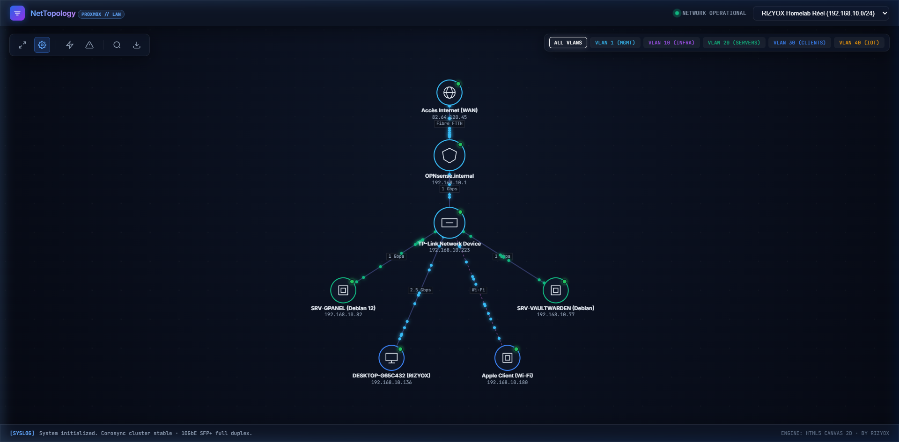

# 🌐 NetTopology — Interactive LAN & Homelab Network Visualizer

[](https://github.com/RIZYOX)
[](LICENSE)
[](https://nodejs.org)

**NetTopology** est un visualiseur interactif de topologie réseau local (LAN) et de clusters de virtualisation (**Proxmox VE, pfSense, UniFi, TrueNAS, Docker**), conçu avec un moteur graphique Canvas 2D fluide à 60 FPS, un système de particules animées simulant le flux des paquets réseau en temps réel, et une suite complète d'outils de diagnostic (ping, balayage ARP de sous-réseau, filtrage par VLAN).



---

## ✨ Fonctionnalités Clés

- 🌍 **Auto-Découverte Universelle du Réseau Réel :** Détecte automatiquement l'interface réseau, le sous-réseau et la passerelle par défaut de la machine hôte pour générer une topologie propre de n'importe quel réseau local en direct.
- 🚀 **Moteur Graphique 2D Haute Performance :** Rendu Canvas avec physique à ressorts (*force-directed graph*), zoom fluide à la molette ciblé sur le curseur, et pan libre.
- ⚡ **Simulation de Trafic Réseau en Temps Réel :** Des particules lumineuses voyagent le long des câbles (SFP+ 10G, RJ45 2.5GbE, liaisons virtuelles vmbr0, Wi-Fi 6).
- 🛡️ **Mode Cyber-Incident / Simulation d'Attaque :** Déclenche un flux d'anomalies de paquets rouges vers le pare-feu avec alertes de sécurité en direct.
- 🏷️ **Segmentation VLAN Interactive :** Filtrez la topologie d'un clic par VLAN (VLAN 1 MGMT, VLAN 10 INFRA, VLAN 20 SERVERS, VLAN 30 CLIENTS, VLAN 40 IOT).
- 🔍 **Inspecteur de Périphérique & Console Ping :** Cliquez sur n'importe quel équipement pour afficher son IP, MAC, services ouverts (SSH, HTTPS, API Proxmox 8006, etc.), et lancer un test ICMP ping interactif.
- 📡 **Scanner de Sous-Réseau LAN :** Balayage ARP réel via l'API Node.js avec animation radar et découverte automatique des hôtes.
- 💾 **Export JSON :** Sauvegardez et exportez vos configurations de réseau en un clic.

---

## 🛠️ Stack Technique

- **Frontend :** HTML5 Sémantique, Canvas 2D API, Vanilla JavaScript moderne (ES6+), Vanilla CSS (Glassmorphism, Dark Cyber Theme, typographie JetBrains Mono).
- **Backend (Optionnel) :** Node.js avec serveur HTTP natif et API de diagnostic ping/interfaces réseau locales (zéro dépendance lourde requise).

---

## 🚀 Démarrage Rapide

### Option A — Avec le serveur Node.js (Recommandé pour les tests réels de ping)
```bash
# Dans le dossier lan-topology-visualizer
node server.js
```
Ouvrez ensuite votre navigateur sur **http://localhost:3000** !

### Option B — Directement dans le navigateur (Mode Standalone)
Double-cliquez simplement sur le fichier `index.html` pour l'ouvrir dans n'importe quel navigateur web.

---

## 📁 Architecture du Projet

```text
lan-topology-visualizer/
├── index.html            # Structure HTML & Interface Glassmorphic
├── style.css             # Design System sombre, thème Tokyo Night & animations
├── app.js                # Contrôleur d'interface, gestion des événements & modals
├── topology-engine.js    # Moteur Canvas 2D, physique à ressorts & particules
├── network-scanner.js    # Moteur de scan de sous-réseau & diagnostic ICMP
├── data-presets.js       # Topologies Homelab RIZYOX & Datacenter Multi-Site
├── server.js             # Serveur HTTP Node.js léger avec API ping
└── package.json          # Métadonnées du projet
```

---

## 👤 Auteur

**RIZYOX**  
- Portfolio : [rizyox.fr](https://rizyox.fr)
- GitHub : [@RIZYOX](https://github.com/RIZYOX)
- Discord : `rizyox_`
